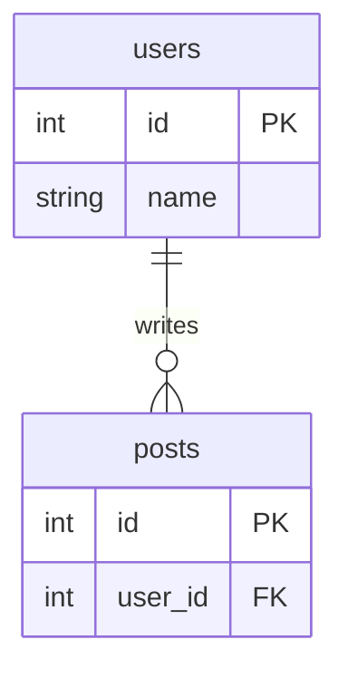

# sqlcard.nvim 🃏

**ER 図のカードを横に置いて、そこから SQL を書く。** DB に繋がなくても、方言に合った補完とテーブル定義が出る。

- プロジェクトごとに 1 枚、mermaid の ER 図を書く「カード」を持てる
- カードのテーブルを選ぶと、今の方言の `CREATE TABLE` が入る
- 補完には、方言ごとのキーワード・型・関数と、カードやプロジェクト内の `.sql` にあるテーブル名・カラム名が出る

カードも方言も nvim の state（`~/.local/state/nvim/sqlcard/`）に保存する。リポジトリには何も置かない。

## 使い方

```vim
:SqlCard            " カードを右に分割して開く / 閉じる
:SqlCard float      " カードをフローティングで開く / 閉じる（q でも閉じる）
:SqlCardInsert      " カードのテーブルを選んで CREATE TABLE を挿入
:SqlDialect         " 方言を選ぶ（:SqlDialect mysql のように直接も指定できる）
```

`.sql` とカードのバッファでは、次のキーも使える。

| キー | 動作 |
|------|------|
| `<leader>Dc` | カードを横に開く / 閉じる |
| `<leader>DC` | カードを浮かせて開く / 閉じる |
| `<leader>Di` | カードから `CREATE TABLE` を挿入 |
| `<leader>Dd` | 方言を切り替え |

## カードから SQL へ



これを PostgreSQL で挿入すると、こうなる。

```sql
CREATE TABLE users (
  id   INTEGER PRIMARY KEY,
  name TEXT
);

CREATE TABLE posts (
  id      INTEGER PRIMARY KEY,
  user_id INTEGER REFERENCES users (id)
);
```

- テーブル名はそのまま使う。`USER` や `OrderItem` のように大文字で書いたときだけ、`users` / `order_items` に直す
- `PK` は主キー、`UK` は `UNIQUE`。`PK` が複数あれば複合主キーにする
- `FK` の参照先は、`user_id` → `users` の命名か、リレーションが 1 本だけのときに決める。決まらなければ `REFERENCES` を付けない
- MySQL では `FOREIGN KEY (...)` をテーブル制約として出す（カラム定義内の `REFERENCES` は無視されるため）
- 知らない型はそのまま出す。`NOT NULL` やデフォルト値は ER 図に情報が無いので付けない

| ER 図の型 | PostgreSQL | MySQL | SQLite |
|------|------|------|------|
| `int` | `INTEGER` | `INT` | `INTEGER` |
| `string` | `TEXT` | `VARCHAR(255)` | `TEXT` |
| `bool` | `BOOLEAN` | `BOOLEAN` | `INTEGER` |
| `datetime` | `TIMESTAMPTZ` | `DATETIME` | `TEXT` |
| `uuid` | `UUID` | `CHAR(36)` | `TEXT` |
| `json` | `JSONB` | `JSON` | `TEXT` |

ほかに `bigint` / `text` / `float` / `decimal` / `date` / `time` / `blob` などに対応。

## 方言

PostgreSQL / MySQL / SQLite。プロジェクト（git のルート）ごとに覚えるので、一度選べば次に開いたときも同じ方言になる。選んでいないプロジェクトは `default_dialect`。

## 補完

[blink.cmp](https://github.com/saghen/blink.cmp) のソースとして動く。候補の右に出どころが出る。

| 表示 | 意味 |
|------|------|
| `pg` / `mysql` / `sqlite` | その方言だけの語彙 |
| `card` | カードに書いたテーブル・カラム |
| `sql` | プロジェクト内の `.sql` の `CREATE TABLE` / `ADD COLUMN` から拾った名前 |
| `buf` | 今のバッファで定義した名前 |

`users.` のようにテーブル名の後ろで打つと、そのテーブルのカラムだけ出る。`DROP` や `RENAME` は追わないので、消したカラムが残ることはある。

## インストール

lazy.nvim:

```lua
{
  'wisteriahuman/sqlcard.nvim',
  ft = 'sql',
  cmd = { 'SqlCard', 'SqlCardInsert', 'SqlDialect' },
  config = function()
    require('sqlcard').setup({
      default_dialect = 'postgres', -- postgres | mysql | sqlite
      keyword_case = 'upper',       -- upper | lower
      card = { width = 50, float = { width = 0.6, height = 0.7 } },
      -- keys = false,              -- キーマップを張らない
    })
  end,
}
```

blink.cmp 側にソースを登録する。

```lua
sources = {
  per_filetype = { sql = { 'sqlcard', 'snippets', 'buffer' } },
  providers = { sqlcard = { name = 'sqlcard', module = 'sqlcard.source' } },
}
```

## 必要なもの

- Neovim 0.10 以上
- blink.cmp（補完を使う場合）
- カードで診断や整形を効かせたいなら [mermaid-lsp](https://github.com/wisteriahuman/mermaid-lsp)

## テスト

```sh
nvim --headless -u NONE --cmd "set rtp+=." -l tests/run.lua
```
